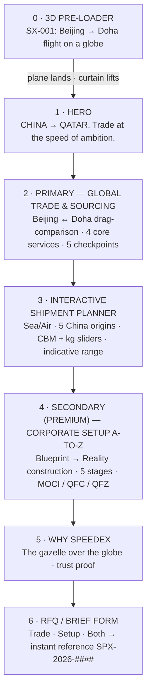

# SPEEDEX — Immersive Website
## Project Architecture, Component Tree & Developer Handover

**Company:** SPEEDEX — For Service & Commercial Mediation
**Core (Primary):** Global Trade & Sourcing, China → Qatar
**Premium complement (Secondary):** A-to-Z Corporate Setup in Qatar
**Date / version:** 19 October 2026 · v1.0 working interactive prototype + production blueprint

> **What you have now:** a runnable, deployable React website (`/home/user/speedex`) implementing the full story — 3D flight pre-loader, trade-first homepage, shipment planner, Blueprint→Reality corporate-setup experience, trilingual EN/AR/中文 with true RTL, and dark/light mode — **plus** the production Next.js + React Three Fiber version of the flight scene (`speedex/nextjs-reference/`) ready to lift into the App Router build described in §4.

---

## 1. Creative direction — how the references were synthesised

| Reference quality requested | How it is expressed in SPEEDEX |
|---|---|
| **“KAGE” — cinematic scroll storytelling** | One continuous journey: *flight → landing → sourcing → shipping → building a company → launch*. GSAP ScrollTrigger reveals, a full-bleed maroon depth gradient on the hero, and curtain-lift exit from the pre-loader. |
| **“Bluebird” — clean, glassmorphic, reactive UI** | Frosted glass cards (`backdrop-filter: blur` + 1px gold hairlines), ultra-clean Space Grotesk / Inter type, elements that fly/fade in on scroll, tilt-rise hover states. |
| **“VELA / Aviation” — luxury & scale** | Oversized display typography (`CHINA → QATAR.` at up to 138px), full-screen Doha aerial, serif italic accent line, restrained gold-on-maroon palette. |
| **Your supplied brand assets** | The 3D dioramas of **Beijing** and **Doha**, the maroon/white SPEEDEX jet, and the 3D maroon logo are used as first-class visuals. The mark itself drives the brand story: *the Qatari gazelle of speed, leaping over the globe.* |

### 1.1 Design tokens (extracted from your logo)

| Token | Value | Use |
|---|---|---|
| `--maroon` | `#8A1538` (Qatar maroon) | Primary brand, CTAs, jet livery, tail fin |
| `--maroon-2 / -3` | `#6E0F2B` / `#4A0A1E` | Gradient depth, marquee band, quote panel |
| `--wine` | `#B4234A` | Highlights, progress, live accents |
| `--gold / --gold-2` | `#C9A86A` / `#E8D5A8` | Accents, hairlines, premium CTAs, flight trail |
| `--beige` | `#F5EFE4` | Light surfaces, fuselage white |
| Dark bg | `#0A0508 → #160810` | Default theme (pre-loader stays dark in both themes — cinematic by design) |
| Light bg | `#F7F2E9 → #FFFAF1` | Light theme |

### 1.2 Typography (trilingual-safe stack)

- **Display:** Space Grotesk → IBM Plex Sans Arabic → Noto Sans SC
- **Body:** Inter → IBM Plex Sans Arabic → Noto Sans SC
- **Luxury accent (italic):** Cormorant Garamond
- Arabic uses reduced letter-spacing (Arabic script must not be tracked out); kickers switch from `.32em` to `.08em` in RTL automatically.

---

## 2. Information architecture & user journey

The page is a **story with a hierarchy**, not a menu of equals: Trade is the hero and the first full chapter; Corporate Setup arrives second, framed as the elite complement (“now that your goods move — build the company that sells them”).



### Global chrome
- Glass fixed nav: gazelle mark, anchors, **↺ Replay flight**, language pill (EN / عربي / 中文), **☀/🌙 theme toggle**, “Get a quote”.
- Language, theme persist in `localStorage` (`spx-lang`, `spx-theme`). Arabic flips `document.dir = rtl` — layout, sliders and the compare divider are built with logical properties (`inset-inline-start`, `start/end`) so they mirror correctly.

---

## 3. What is implemented in this prototype (file map)

```
speedex/
├── index.html                      # fonts (EN/AR/ZH), title, meta, favicon = gazelle mark
├── vite.config.ts                  # React + Tailwind v4, host 0.0.0.0:5173
├── public/assets/                  # YOUR images, cropped/optimised (see §8.2)
│   ├── beijing.jpg  doha-aerial.jpg  doha-waterfront.jpg
│   ├── speedex-jet.jpg  logo-full.jpg  gazelle-globe.jpg  wordmark.jpg
├── src/
│   ├── main.tsx  App.tsx           # state: lang / theme / entered / flight replay; GSAP reveals
│   ├── index.css                   # design tokens (dark+light), glass, buttons, marquee, range inputs
│   ├── i18n.ts                     # FULL dictionary — en / ar / zh (every UI string)
│   ├── components/
│   │   ├── Nav.tsx                 # glass nav, language pill, theme toggle
│   │   └── three/
│   │       └── FlightPreloader.tsx # ★ Three.js globe + procedural SPEEDEX jet (see §5)
│   └── sections/
│       ├── Hero.tsx                # full-screen Doha, giant type, floating jet card, stats, marquee
│       ├── Trade.tsx               # Beijing↔Doha compare slider, services, 5 checkpoints, Planner
│       ├── Corporate.tsx           # BlueprintSVG + photo reveal, construction slider, structures
│       └── Closing.tsx             # Why SPEEDEX, RFQ form (generates reference), footer
└── nextjs-reference/
    └── components/three/FlightPreloaderR3F.tsx   # ★ production Next.js/R3F version (see §4–§5)
```

Run it:

```bash
cd speedex
npm install
npm run dev        # http://localhost:5173
npm run build      # type-check (tsc -b) + production bundle → dist/
```

---

## 4. Production target — Next.js architecture (App Router)

The prototype’s components port 1:1. Production adds locale routing, SSR/SEO and a real RFQ backend:

```
speedex-web/                              # Next.js 14/15 · App Router · TypeScript
├── app/
│   ├── [locale]/                         # en | ar | zh  (next-intl, dir set per locale)
│   │   ├── layout.tsx                    # fonts, ThemeProvider, <Nav/>, JSON-LD Organization
│   │   ├── page.tsx                      # composes the story (Server Component shell)
│   │   ├── trade/page.tsx                # phase-2 deep page: sourcing, QC, Incoterms, HS-code guide
│   │   ├── setup/page.tsx                # phase-2 deep page: MOCI vs QFC vs QFZ, timelines, fees
│   │   └── api/rfq/route.ts              # POST → validate (zod) → CRM + email + WhatsApp notify
│   ├── sitemap.ts  robots.ts             # hreflang en/ar/zh alternates
│   └── globals.css                       # ← port of src/index.css tokens
├── components/
│   ├── three/
│   │   ├── FlightPreloader.tsx           # ← FlightPreloaderR3F.tsx (dynamic import, ssr:false)
│   │   ├── SpeedexJet.tsx                # procedural now → /models/speedex-jet.glb later
│   │   ├── Globe.tsx  RouteArc.tsx CityMarker.tsx
│   │   └── BlueprintTower.tsx            # R3F version of Blueprint→Reality (see §6)
│   ├── sections/  (Hero, Trade, Planner, Corporate, Why, QuoteForm, Footer)
│   └── ui/        (GlassCard, MagneticButton, Marquee, CompareSlider, RangeField)
├── lib/  gsap.ts · theme.ts · routes.ts (ROUTE coords) · pricing.ts (planner rules)
├── messages/  en.json  ar.json  zh.json   # ← generated from src/i18n.ts keys
└── public/  assets/ (images)  models/ (GLB, Draco+KTX2)  video/ (hero loop, poster fallbacks)
```

**Key production rules**
1. **Never block first paint on WebGL.** `dynamic(() => import('.../FlightPreloader'), { ssr: false })`; the hero HTML renders underneath the curtain exactly as in the prototype.
2. **GLB pipeline:** model livery in Blender (maroon tail/belly, SPEEDEX titles) → export GLB → `gltf-transform` (Draco geometry + KTX2 textures, target ≤ 1.2 MB) → `<useGLTF>` + `<Preload>`. Flight math is model-agnostic (nose = +Z convention).
3. **i18n:** next-intl with `[locale]` segments; Arabic route serves `dir="rtl"` from the server (no post-hydration flip). All CSS uses logical properties from day one (already true in the prototype).
4. **RFQ backend:** `POST /api/rfq` → zod validation → persist (Postgres/CRM) → notify (email + WhatsApp Business API) → return the same `SPX-2026-####-TRD|SET|ALL` reference the prototype generates, so UX doesn’t change.
5. **CMS (optional phase 2):** Sanity/Contentful for route pages, case studies and the planner’s rate tables.

### 4.1 Component tree (production page)

```
<LocaleLayout>
└── <HomePage>
    ├── <FlightPreloader onLanded>            (client, dynamic ssr:false)
    │   └── <Canvas> <FlightScene> <Globe/> <RouteArc/> <SpeedexJet/> <CityMarker×2/> </FlightScene> + HUD overlay
    ├── <Nav>  logo · links · <LocaleSwitch/> · <ThemeToggle/> · CTA
    └── <main>
        ├── <Hero>            giant type · jet card · stat glass · <Marquee/>
        ├── <Trade>           <CompareSlider Beijing/Doha/> · services · 5 checkpoints
        ├── <ShipmentPlanner> mode toggle · origin select · CBM/kg ranges · result tiles
        ├── <CorporateSetup>  <BlueprintToReality/> (scrub + slider) · stages · structures
        ├── <WhySpeedex>      logo story · 3 trust cards
        └── <QuoteForm>       service select → /api/rfq → reference state
    └── <Footer>
```

---

## 5. The 3D flight pre-loader — how it works

**Scene (both implementations share identical math):**

1. **Globe** — dark maroon-tinted sphere (R = 2.25), 2,400-point Fibonacci dot-shell in muted gold (land-mass feel without a texture download), lat/long wireframe loops, gold back-side atmosphere halo, 900 stars, exponential fog.
2. **Geography is real.** Beijing `39.9042°N, 116.4074°E` and Doha `25.2854°N, 51.5310°E` convert via the standard spherical mapping
   `φ=(90−lat)`, `θ=(lon+180)` → `x=−r·sinφ·cosθ, y=r·cosφ, z=r·sinφ·sinθ`.
   The world group is pre-rotated `rotation.y = −atan2(mid.x, mid.z)` so the route midpoint faces camera (+Z) — verified numerically; the great-arc is `lerp(start,end,t).normalize() × (R + sin(πt)·0.92)` giving a 0.92-unit cruise apex.
3. **The jet is procedural** (no external model needed to ship): white capsule fuselage, maroon belly stripe, tail fin, stabiliser, wing tips and twin engines, steel intakes, dark cockpit + windows — and **“SPEEDEX · CHINA → QATAR” decals rendered to a `CanvasTexture`** on both fuselage sides. Nose = +Z; each frame the orientation basis is built from `forward = next − pos`, `up = normalize(pos)` (radial), `x = up × fwd`, `y = fwd × x` — so the jet banks naturally along the arc.
4. **Timeline (≈6.4 s, skippable, `prefers-reduced-motion` → 1.6 s):** boarding pulse at Beijing → eased (`easeInOutCubic`) flight with a gold trail drawn by `setDrawRange`, pulsing city rings, HUD counting **km flown / 6,318 km** and **%** with phase captions (Boarding → Take-off → Cruising → Descent → Landed) in the active language → curtain translates −100% with a `cubic-bezier(.76,0,.24,1)` lift into the hero. Cursor movement parallaxes camera + globe tilt. Full dispose/cleanup on unmount.

**Performance budget:** 1 canvas, `dpr ≤ 2`, < 30 draw calls, no textures fetched (canvas-generated decal) → comfortably 60 fps on mid mobile; lazy-mount prevents it ever delaying LCP content.

---

## 6. Blueprint → Reality (Corporate Setup)

- **Prototype (shipped):** an SVG “West Bay” blueprint (drawing no. `DWG-QA-001`) on blueprint-grid stock. Windows light floor-by-floor as *construction progress* rises; the real Doha skyline photograph is revealed upward via `clip-path: inset(100−p% 0 0 0)` under a glowing gold scanline. Driven three ways — **auto-plays once on scroll into view** (IntersectionObserver), **draggable slider**, and **▶ Replay**. The 5 legal/operational stages check off at 6/28/52/76/96%.
- **Production upgrade path:** pin the section with GSAP ScrollTrigger `scrub` mapping scroll → the same `build` variable, and/or replace the SVG with an R3F tower (`BlueprintTower.tsx`: wireframe `EdgesGeometry` → solid materials + emissive windows lerped by `build`). The stage/checkpoint logic is unchanged.

Note on content: MOCI Mainland / QFC / Free Zones cards are **positioning copy, not legal advice** — the prototype carries that disclaimer, and §9 flags legal review before launch.

---

## 7. Interactive systems (prototype logic → production owner)

| System | Prototype behaviour | Productionise by |
|---|---|---|
| Beijing ↔ Doha compare | Pointer-drag + keyboard (←/→) divider, RTL-aware clip | Add pinch/scroll-linked variant on `/trade` page |
| Shipment Planner | Sea: `CBM × origin rate + 650`; Air: chargeable kg = `max(kg, CBM×167)` × $4.9 + 380; ±(−15%/+20%) indicative band; transit windows & equipment (LCL/20ft/40ft/40HQ) per origin; animated fill meter | **Replace demo rates with SPEEDEX’s real rate card** in `lib/pricing.ts`; disclaimers already in UI in 3 languages |
| RFQ form | Validates, returns `SPX-2026-####-{TRD,SET,ALL}` instantly | Wire to `/api/rfq` (+CRM/WhatsApp) keeping the same reference format |
| Theme / language | `data-theme` on `<html>`, `dir` flip, persisted | Cookie-based in Next to avoid FOUC; locale from URL segment |

---

## 8. Assets & brand notes

### 8.1 Logo observation (important)
Your uploads contain **two different marks** above the globe: a **leaping gazelle** (realistic) and a **stylised lightning-bird**. The site standardises on the **gazelle over the globe** — it is distinctly Qatari (oryx/gazelle national symbolism), matches the aircraft livery intent, and carries the “speed” story in §5 of the page. Recommendation: retire the lightning-bird variant everywhere for one consistent identity.

### 8.2 Asset preparation done
Originals are untouched in `uploads/`. Working copies in `speedex/public/assets/` were tight-cropped (jet card 1330×697, gazelle icon 432×442, wordmark 1008×287) and JPEG-optimised (~1.5 MB total). For production, supply/commission: transparent-background logo (SVG/PNG), the jet as a Blender GLB, and a 6–10 s hero video loop (Hamad Port cranes / HIA cargo) with poster fallback = the Doha aerial.

---

## 9. Decisions needed from SPEEDEX before production launch

1. **Real planner economics:** per-origin sea $/CBM, air $/kg tiers, minimums, and what the “indicative” band may legally promise.
2. **Corporate-setup facts:** confirmed activities, timelines & government-fee ranges for MOCI / QFC / QFZ; legal sign-off of all setup copy.
3. **Contact & conversion endpoints:** WhatsApp Business number, RFQ inbox/CRM, office address(es) in Doha & China, CR number for the footer.
4. **Domain & analytics:** domain (e.g. speedex.qa), GA4/Matomo, consent approach for QA/CN audiences.
5. **Asset rights:** confirm the AI-generated dioramas/jet imagery are cleared for commercial use, or schedule real photography.

---

## 10. QA checklist (prototype verified)

- [x] `npm run build` — TypeScript strict + Vite production build pass
- [x] Pre-loader: flight completes → curtain lift; **Skip** works; scroll locked until landing; replay from nav/footer
- [x] Trilingual switch incl. full RTL mirror (nav, sliders, compare divider, marquee direction)
- [x] Dark/light toggle across all sections (pre-loader intentionally stays cinematic-dark)
- [x] Planner math updates live (mode, origin, CBM, kg → transit, range, equipment, chargeable weight)
- [x] Blueprint auto-builds on scroll, slider overrides, replay restarts; stages check off
- [x] RFQ form generates reference; keyboard-accessible compare slider; `prefers-reduced-motion` respected
- [ ] Production-only: GLB jet swap, `/api/rfq`, locale routing + hreflang, legal/rate sign-off (§9)

*Built as a working prototype on React + Three.js + GSAP + Tailwind (Vite harness for instant preview); the component and scene code is structured to lift directly into the Next.js App Router target in §4.*
